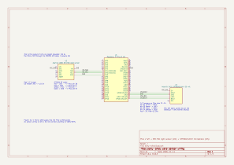

# Hardware

Wiring for the early-bird wake sensor: a Raspberry Pi Pico 2 WH with a BH1750
light sensor (I2C) and an SPH0645LM4H microphone (I2S).

- `early-bird.kicad_sch`: KiCad schematic (open `early-bird.kicad_pro`)
- `early-bird.pdf`, `early-bird.svg`: exports of the schematic

## Parts

| Ref | Part | Notes |
|---|---|---|
| U1 | Raspberry Pi Pico 2 WH (SC1634) | Headers pre-soldered |
| U2 | Adafruit 4681, BH1750 light sensor | STEMMA QT port, plus a soldered pin header for `3Vo` |
| U3 | Adafruit 3421, SPH0645LM4H I2S microphone | 6-pin header must be soldered |
| | Adafruit 4397, STEMMA QT to female sockets, 150 mm | |
| | Adafruit 266, F/F jumper ribbon | Five wires are used: yellow, brown, black, orange, red |
| | Raspberry Pi 5.1 V micro-USB power supply (SC0624) | |

Also needed: soldering iron and solder, and a micro-USB **data** cable for
flashing (the power supply's cable is power only).

## Pin map

Pico pin numbers are the physical pins, 1 to 40. With the USB socket at the
top and the chips facing you, pin 1 is top left, pin 20 bottom left, pin 21
bottom right and pin 40 top right.

| Signal | Pico pin | Pico GPIO | Goes to | Wire |
|---|---|---|---|---|
| 3V3 | 36 | 3V3(OUT) | U2 STEMMA QT, VIN | STEMMA cable, red |
| I2C SDA | 6 | GP4 | U2 STEMMA QT, SDA | STEMMA cable, blue |
| I2C SCL | 7 | GP5 | U2 STEMMA QT, SCL | STEMMA cable, yellow |
| GND | 8 | GND | U2 STEMMA QT, GND | STEMMA cable, black |
| I2S BCLK | 21 | GP16 | U3 `BCLK` | Jumper, yellow |
| I2S LRCL (word select) | 22 | GP17 | U3 `LRCL` | Jumper, brown |
| GND | 23 | GND | U3 `GND` | Jumper, black |
| I2S DOUT | 24 | GP18 | U3 `DOUT` | Jumper, orange |
| Mic 3V | none | | U2 header `3Vo` to U3 `3V` | Jumper, red |

U3 `SEL` stays unconnected: the breakout pulls it low, which selects the left
channel.

The Pico has a single 3V3 output pin, and both sensors need it. The
microphone is therefore powered from the `3Vo` pin of the BH1750 breakout.
`3Vo` is the output of that board's regulator, which is fed by the Pico's
3V3 through the STEMMA QT cable.

## Assembly

Do all of this with the Pico unplugged.

1. **Solder the headers.** Use 60/40 solder at about 320 °C, 2 to 3 seconds
   per joint.
   - U3: a 6-pin header. The microphone is bottom-ported: sound enters
     through the small hole in the PCB, on the face opposite the metal can.
     Put the long pins on the same side as the metal can, so the face with
     the hole stays flat and can later sit against a hole in the enclosure.
     Keep solder and flux away from the port hole, and never blow compressed
     air into it.
   - U2: a pin header, of which only `3Vo` is used.
2. **Optional: disable the BH1750 power LED.** U2 has an always-on green LED.
   For a dark bedroom, cut the LED jumper trace on the back of the board with
   a craft knife. Tape over the LED works too.
3. **STEMMA QT cable, Pico to light sensor.** Plug the JST end into either
   port of U2, then push the four sockets onto the Pico:
   - red on pin 36
   - blue on pin 6
   - yellow on pin 7
   - black on pin 8
4. **Jumpers, Pico to microphone.** Four F/F jumpers go from Pico pins 21
   to 24, which are adjacent, to U3. Go by the labels printed on the
   breakout:
   - yellow: pin 21 to `BCLK`
   - brown: pin 22 to `LRCL`
   - black: pin 23 to `GND`
   - orange: pin 24 to `DOUT`
5. **Jumper, microphone power.** A red F/F jumper goes from U2 `3Vo` to
   U3 `3V`.
6. **Check before powering.**
   - The red STEMMA wire is on Pico pin 36, and the red jumper only touches
     U2 `3Vo` and U3 `3V`.
   - Nothing is connected to pins 39 or 40 (VSYS, VBUS): those carry 5 V and
     would damage the sensors' signal pins and the Pico.
   - U3 `SEL` is empty.
7. **Power up** with the micro-USB supply or a USB cable from a computer.

## Placement

- Point the BH1750 at the room and its lamp, not at the window.
- Put the microphone's port hole facing the room, near the bed or the door.
- Keep the Pico's antenna end (opposite the USB socket) away from metal.
